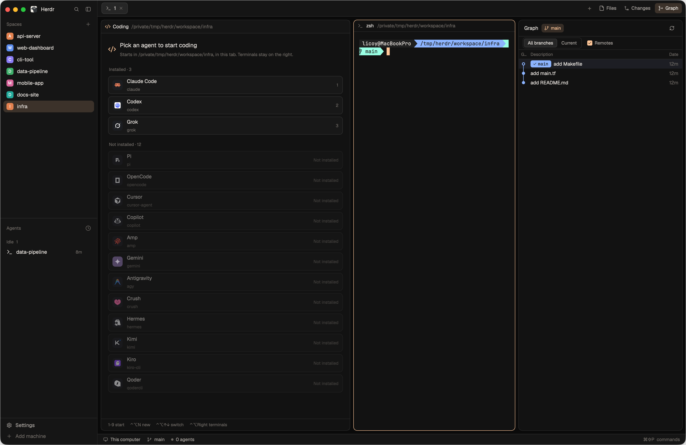

# herdr-mttnb

English | [中文](README_ZH.md)

A layout and theme for the Herdr desktop app: a fixed column of coding agents on the left, terminals on the right as usual, and a Git commit graph you can open beside them.



## Features

- **Coding column on the left**: lists every agent Herdr supports (installed ones first; the others folded into one line, click to see them). Click one, or press `1`–`9`, to start it in the current tab's first terminal's root process folder, read afresh before launch even while another program runs in front.
- **Each tab has its own agents**: a new tab starts with an empty picker. A tab can run several agents: switch between them with the tabs at the top of the column, `+` opens another, and "End" (click twice) ends the shown one.
- **Closing splits leaves the column alone**: the column's agents don't belong to any terminal pane, so closing panes or terminals on the right never takes them down. They end when their tab closes.
- **The sidebar's Agents list** also shows the column's agents; click one to jump to it. The status bar counts them too, and how many are working.
- **Git at a glance**: after each space's name, its current branch, then `●n` uncommitted changes, `↑n` commits to push and `↓n` to pull (hidden at zero).
- **Space icons**: each space gets its own identicon (a mirrored 5×5 pattern on its colour, the same every time). Right-click a space → **Change icon…** to use an emoji or a picture instead (drop one in, or **Choose…** on macOS).
- **Pull / Push**: right-click a space in a git repo with a remote → **Pull** (fast-forward only) or **Push** (a branch with no upstream yet goes to `origin` and tracks it). An arrow pulses after the name while it runs, then a toast says how it went.
- **New space in any folder**: `+` beside **Spaces** (or on a machine's header) asks for the folder: type a path (`~` works), **Choose…** one with the system's picker (this computer only), or click one used before. The unchecked **Create folder if missing** option lets you opt into creating a missing folder on the target machine; otherwise the folder must exist. Failures keep the form open and show the error. The new space starts there instead of in the shown space's folder.
- **Privacy**: the eye button beside **Spaces** masks the names of spaces and groups, and the space and tab names in the Agents list, keeping only their first and last characters (`study-grok` shows as `s****k`), for sharing your screen; it stays highlighted while on, and a click shows the names again.
- **Space groups**: the folder button beside **Spaces** makes a group with a name and an icon (a folder, an emoji or a picture). Its spaces hang under it on a tree line, and a divider sets the spaces in no group apart; click the header to fold or unfold it. A folded group sums up its spaces after its name: the most urgent agent's status and their `●n` `↑n` `↓n`. Drag a space onto a group's header (or among its spaces), or right-click it → **Move to …**. Right-click a group to edit, move or delete it; deleting one puts its spaces back in the list.
- **Graph panel**: the Files / Changes / Graph buttons on the right of the tab bar open that panel on the right; click again to close it. Graph needs the Git Graph mod (see below); without it the button doesn't show.
- **Discard changes**: in the Changes panel, hover a file and click the undo arrow to throw away its changes (an untracked file is deleted), or **Discard all** for every file. The button turns red and says "Click again to discard"; a second click within 3 seconds does it.
- **Colours**: a dark theme `mttnb-dark` and a light theme `mttnb-light` in Atom One Dark's and Atom One Light's colours, following the system appearance.

## Install

Requires the Herdr desktop app 0.1.11 or later.

```sh
git clone https://github.com/Licoy/herdr-mttnb
sh herdr-mttnb/install.sh
```

The script copies `layouts/`, `themes/` and `mods/` into `~/.config/herdr-app` (or `HERDR_APP_HOME` when set), merges the key bindings into `keys.json` (the old file is kept as `keys.json.bak`), then switches to the mttnb layout.

To install by hand, copy the `layouts`, `themes` and `mods` folders into your Herdr home, add the `layout:mttnb` section of `keys.json` to your own `keys.json`, then run:

```sh
herdr-app do layout.switch '{"name":"mttnb"}'
```

### Graph panel (optional)

```sh
git clone https://github.com/rabeeh-ta/herdr-git-graph
cp -R herdr-git-graph/mods/git-graph ~/.config/herdr-app/mods/
```

Git Graph only runs `git` in your repositories, and goes online only when you click Fetch / Push.

## Keys

Active in the mttnb layout only.

| Key | Action |
| --- | --- |
| `Ctrl+Shift+A` | Back to the column's agent (opens the picker when there is none) |
| `Ctrl+Alt+N` | Start another agent |
| `Ctrl+Alt+↑` / `Ctrl+Alt+↓` | Previous / next agent in the column |
| `Ctrl+Alt+←` / `Ctrl+Alt+→` | Move between the column and the terminals |
| `Cmd+G` | Open / close Graph |
| `Ctrl+Shift+F` | Open / close Files |
| `Ctrl+Shift+G` | Open / close Changes |

## Notes

- The column's agents are background terminals started with `hc run --no-parent`, labelled `mttnb.role=desk`, `mttnb.space`, `mttnb.tab` and `mttnb.agent`; `hc ls` lists them.
- Starting agents in the column isn't supported yet for spaces on remote machines.
- `mods/mttnb-tabs`, `mods/mttnb-agents`, `mods/mttnb-spaces`, `mods/mttnb-status` and `mods/mttnb-changes` are clones of Herdr's own `tabs`, `agents`, `spaces`, `workspace-status` and `changes` mods, modified.
- Space icons and groups are kept in Herdr's shared state; pictures are copied to `~/.config/herdr-app/data/mttnb-spaces/icons/`.
- Icons are from [Remix Icon](https://remixicon.com) (Apache-2.0).

## Uninstall

Delete these from `~/.config/herdr-app` and remove the `layout:mttnb` section from `keys.json`:

```
layouts/mttnb.json
layouts/mttnb.svg
themes/mttnb-dark.json
themes/mttnb-light.json
mods/mttnb-desk/
mods/mttnb-tabs/
mods/mttnb-agents/
mods/mttnb-spaces/
mods/mttnb-status/
mods/mttnb-changes/
data/mttnb-spaces/
```

## License

[MIT](LICENSE)
