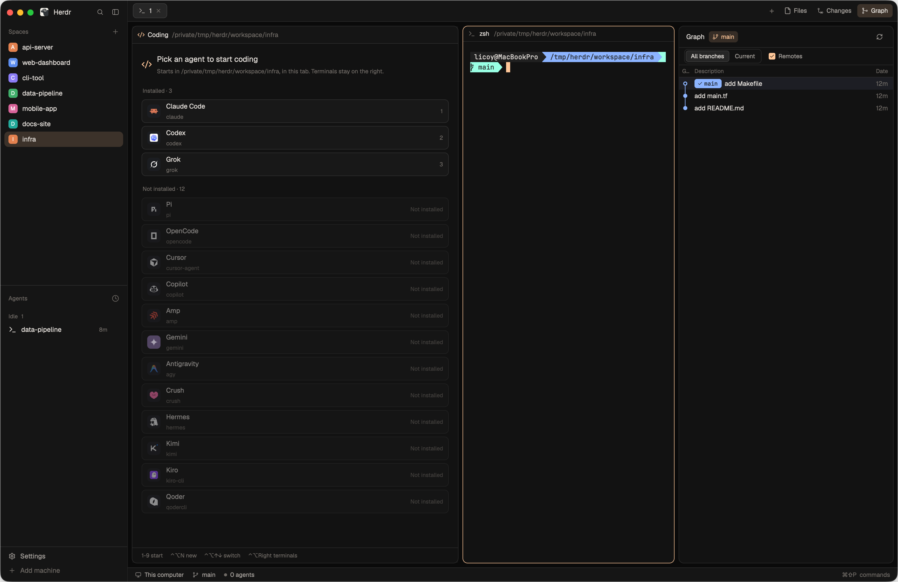

# herdr-mttnb

[English](README.md) | 中文

Herdr 桌面版的布局与主题：左侧固定一栏写代码的 Agent，右侧照常开终端，旁边可以展开 Git 提交图。



## 功能

- **左侧 Coding 栏**：默认列出 Herdr 支持的所有 Agent（已安装的在前，未安装的收成一行，点开才列出来），点一下或按 `1`–`9` 就在当前目录启动。
- **每个 tab 各有一组 Agent**：新开的 tab 左栏是空的选择列表；同一个 tab 可以开多个 Agent，在栏顶的标签之间切换，`+` 再开一个，「End」点两次关掉当前这个。
- **关分屏不影响左栏**：左栏的 Agent 不挂在任何终端分屏下面，关掉右侧的分屏或终端都不会把它带走；关掉它所在的 tab 时才一起结束。
- **侧边栏 Agents 列表**也会列出左栏的 Agent，点击直接跳过去。底部状态栏也会把它们算进 Agent 数，并显示有几个正在工作。
- **Git 状态一目了然**：每个空间名字后面显示当前分支，然后是 `●n` 待提交的改动、`↑n` 待推送和 `↓n` 待拉取的提交（为 0 时不显示）。
- **空间图标**：每个空间默认有自己的 Identicon（空间颜色上的 5×5 对称图案，同一个空间每次都一样）。右键空间 → **Change icon…** 可以换成 emoji 或图片（拖进来，macOS 上也可以点 **Choose…** 选择）。
- **Pull / Push**：空间在有远程仓库的 git 仓库里时，右键 → **Pull**（只快进）或 **Push**（还没有上游的分支会推到 `origin` 并跟踪它）。执行时名字后面有个闪烁的箭头，完成后弹出提示告诉你结果。
- **在任意文件夹新建空间**：**Spaces** 旁边（或某台机器标题上）的 `+` 会弹窗询问文件夹：输入路径（支持 `~`）、点 **Choose…** 用系统选择器挑一个（仅本机），或点一个用过的文件夹。新空间就建在那里，而不是沿用当前空间的文件夹。
- **隐私模式**：**Spaces** 旁边的眼睛按钮会给空间名、分组名，以及 Agents 列表里的空间名和 tab 名打码，只留首尾字符（`study-grok` 显示为 `s****k`），适合共享屏幕时用；开启时按钮高亮，再点一下恢复显示。
- **空间分组**：**Spaces** 旁边的文件夹按钮新建分组，分组有名称和图标（文件夹、emoji 或图片）。组内的空间挂在分组下面的树形连线上，未分组的空间用分隔线隔开；点分组标题可以展开或折叠。折叠后，分组名后面会汇总组内空间的情况：最紧急的 Agent 状态，以及 `●n` `↑n` `↓n` 的合计。把空间拖到分组标题上（或组内空间之间），或者右键空间 → **Move to …** 就能放进分组。右键分组可以编辑、移动或删除；删除分组后，里面的空间回到列表中。
- **Graph 面板**：tab 栏右侧的 Files / Changes / Graph 按钮在右边展开对应面板，再点一次收起。Graph 需要另外安装 Git Graph mod（见下文），没装时不显示这个按钮。
- **撤回更改**：在 Changes 面板里，鼠标移到文件上点撤回箭头，丢弃这个文件的改动（未跟踪的文件会被删除）；或者点 **Discard all** 撤回全部文件。按钮会变红并显示「Click again to discard」，3 秒内再点一次才会执行。
- **配色**：深色主题 `mttnb-dark` 和浅色主题 `mttnb-light`，分别是 Atom One Dark 和 Atom One Light 的配色，跟随系统外观自动切换。

## 安装

需要 Herdr 桌面版 0.1.11 及以上。

```sh
git clone https://github.com/Licoy/herdr-mttnb
sh herdr-mttnb/install.sh
```

脚本会把 `layouts/`、`themes/`、`mods/` 复制到 `~/.config/herdr-app`（设置了 `HERDR_APP_HOME` 时用它），把快捷键合并进 `keys.json`（原文件备份为 `keys.json.bak`），然后切换到 mttnb 布局。

手动安装：把 `layouts`、`themes`、`mods` 三个目录复制进 Herdr 目录，把 `keys.json` 里的 `layout:mttnb` 一段加进你自己的 `keys.json`，再执行：

```sh
herdr-app do layout.switch '{"name":"mttnb"}'
```

### Graph 面板（可选）

```sh
git clone https://github.com/rabeeh-ta/herdr-git-graph
cp -R herdr-git-graph/mods/git-graph ~/.config/herdr-app/mods/
```

Git Graph 只在你的仓库里执行 `git`，只有点 Fetch / Push 时才联网。

## 快捷键

仅在 mttnb 布局下生效。

| 按键 | 作用 |
| --- | --- |
| `Ctrl+Shift+A` | 回到左栏的 Agent（没有时打开选择列表） |
| `Ctrl+Alt+N` | 再开一个 Agent |
| `Ctrl+Alt+↑` / `Ctrl+Alt+↓` | 切换左栏的上一个 / 下一个 Agent |
| `Ctrl+Alt+←` / `Ctrl+Alt+→` | 在左栏和右侧终端之间移动 |
| `Cmd+G` | 展开 / 收起 Graph |
| `Ctrl+Shift+F` | 展开 / 收起 Files |
| `Ctrl+Shift+G` | 展开 / 收起 Changes |

## 说明

- 左栏的 Agent 是用 `hc run --no-parent` 启动的后台终端，带有 `mttnb.role=desk`、`mttnb.space`、`mttnb.tab`、`mttnb.agent` 标签，可以用 `hc ls` 查看。
- 远程机器上的空间暂不支持在左栏启动 Agent。
- `mods/mttnb-tabs`、`mods/mttnb-agents`、`mods/mttnb-spaces`、`mods/mttnb-status` 和 `mods/mttnb-changes` 由 Herdr 自带的 `tabs`、`agents`、`spaces`、`workspace-status`、`changes` mod 克隆后修改而来。
- 空间图标和分组保存在 Herdr 的共享状态里；选用的图片会复制到 `~/.config/herdr-app/data/mttnb-spaces/icons/`。
- 图标来自 [Remix Icon](https://remixicon.com)（Apache-2.0）。

## 卸载

删除 `~/.config/herdr-app` 下的这些文件，并去掉 `keys.json` 里的 `layout:mttnb` 一段：

```
layouts/mttnb.json
layouts/mttnb.svg
themes/mttnb-dark.json
themes/mttnb-light.json
mods/mttnb-desk/
mods/mttnb-tabs/
mods/mttnb-agents/
mods/mttnb-spaces/
mods/mttnb-status/
mods/mttnb-changes/
data/mttnb-spaces/
```

## 许可

[MIT](LICENSE)
