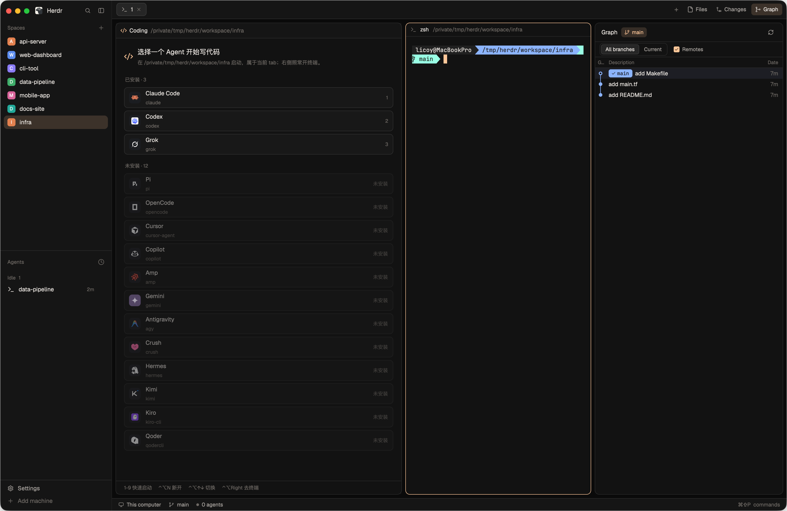

# mttnb

Herdr's own window with a coding desk built in: the sidebar lists spaces and agents, and the work area is split into three cards. On the left a fixed Coding column holds the shown tab's agents: with none it lists every agent Herdr knows, and a click starts one. In the middle are the tab's terminals as usual. On the right a Files / Changes / Graph panel opens from the tab bar. The colours are warm: amber `#ffc799` on near-black in dark mode, rust `#c4692c` on warm white in light mode, following the system appearance.

## What you see

Left to right, at zoom 1:

- **Sidebar**, 248px wide (44–480), on `chrome`, no system title bar (macOS traffic lights at 12, 16):
  - top 46px: Herdr's brand row with search and fold buttons (drags the window);
  - Spaces list and Agents list, sharing the height equally (each at least 90px). The Agents list also shows the Coding column's agents;
  - bottom 69px: Settings and Add machine.
- A 1px `border` divider.
- **Work column** on `canvas`:
  - top 42px: the tab bar (drags the window): tabs as pills with a `+` menu; on the right `+`, then Files, Changes and Graph buttons (Graph only when the git-graph mod is installed); the open panel's button is highlighted;
  - the body, 8px padding and 8px gaps, three cards side by side:
    - **Coding column**, weight 1 (at least 360px), on `background`, radius 10, 1px `border` (the accent when it has the keyboard):
      - a 34px header on `chrome`, 12.5px text. With no agent: a 14px accent code icon, "Coding" and the tab's folder in `dim`. With agents: one 26px tab per agent (program icon, name, a `working` spinner or a `blocked` / `done` 6px dot; the shown one on `raised` with a `border` outline), "Claude Code 2" for the same program twice; then a 24px `+` (on `selected` while the picker shows) and an "End" button (`结束`) at 11.5px;
      - below it, the shown agent's terminal (6px padding), or the **picker**: a 20px accent code icon and a 15px title ("选择一个 Agent 开始写代码", or "再开一个 Agent" when the tab already has some), an 11.5px line on where it starts; then "已安装 · n" with one 46px row per installed agent (26px program tile, name in 13px semibold, its command in 11px `dim`, its 1–9 key on the right; `surface` with a `border` outline, `selected` with an accent outline on hover), then "未安装 · n" with the rest at half opacity marked "未安装"; a 30px footer of key hints in 11px `dim`;
    - **the tab's panes**, weight 1 (at least 280px): Herdr's pane cards on `background`, radius 10, 1px `border`, accent border on the focused one, 30px `pane` header on top, 8px gaps;
    - **panel**, 380px (280–900), hidden at start: a stack of Files, Changes and Graph;
  - bottom 28px: status bar (machine, branch, agent count, command palette hint).
- Terminals: padding 14 × 12.

Colours (`themes/mttnb-dark.json` / `themes/mttnb-light.json`):

| token | dark | light |
| --- | --- | --- |
| background | `#121212` | `#fbf8f4` |
| canvas | `#0a0a0a` | `#ece6df` |
| chrome | `#151515` | `#f3eee8` |
| surface | `#181818` | `#f7f3ee` |
| raised | `#262626` | `#e8e1d9` |
| foreground / muted / dim | `#e6e1dc` / `#a8a39e` / `#6f6a65` | `#2b2724` / `#6b645e` / `#9a928b` |
| accent | `#ffc799` on `#1a1208` | `#c4692c` on `#ffffff` |
| border | `#ffffff1a` | `#0000001a` |
| selected | `#ffc79929` | `#c4692c24` |
| working / blocked / done / idle | `#8cb4ff` / `#ffb86b` / `#99ffe4` / `#5f5a55` | `#2f6fd6` / `#c47a0a` / `#1d8c6c` / `#a59d96` |

The ANSI palettes are in the theme files.

## How it behaves

- **Agents per tab.** Each tab has its own Coding column. A new tab shows the picker; switching tabs switches the column to that tab's agents and the one it last showed.
- **Starting one.** Clicking an installed agent in the picker (or pressing 1–9 while it has the keyboard) starts it in the tab's first terminal's folder (else the space's), adds it as a tab in the header and shows it with the keyboard in it. Not-installed agents do nothing. In a space on another machine the rows are dimmed and the picker says it only works on this computer.
- **Several agents.** `+` in the header (or Ctrl+Alt+N) shows the picker again; the running agents keep running. A header tab shows its agent; Ctrl+Alt+Up / Down go to the previous / next.
- **Ending one.** "End" turns into "再点一次结束" in the `blocked` colour for 3 seconds; a second click ends the shown agent and the column shows the next one, or the picker when none are left.
- **Statuses.** A working agent's header tab has a spinning `working` spinner; blocked and done show a 6px dot in their colour; idle shows nothing. The sidebar's Agents list groups the column's agents with the rest, by status; clicking one there shows its tab and its agent.
- **Lifetime.** Closing panes, splits or terminals on the right never touches the column's agents. Closing a tab ends its agents; closing a space ends the agents of all its tabs.
- **Keyboard between column and panes.** Ctrl+Alt+Left from the leftmost pane goes into the column (the agent, or the picker); Ctrl+Alt+Right from the column goes back to the pane the tab was last in. Ctrl+Shift+A goes to the shown agent, or the picker.
- **Panel.** Files, Changes and Graph (or Ctrl+Shift+F, Ctrl+Shift+G, Cmd+G) open that panel on the right; the same button again closes it; another button switches it. Its width and whether it is open stay as left.

## Built from

- **Layout `layouts/mttnb.json`**, cloned from `main` 0.1.11: root row `sidebar` (column: `brand` `workspace-chrome`, `sidebar-lists` with `spaces` and `agents` (mod `mttnb-agents`), `sidebar-footer` `workspace-chrome` with `{footer: true}`) and `work` (column: `tabs` mod `mttnb-tabs`, `work-body` row, `status` `workspace-status`). `work-body` holds:
  - `desk`, a column: `desk-header` (mod `mttnb-desk`, role header) and `desk-stack`, a stack of `picker` (`{role: "picker"}`), `spare` (`{role: "spare"}`) and, added at run time, one `desk-<terminal>` block per agent (`{terminal: <address>}`, padding 6);
  - `main`: `{tab: "active", pane: {...}}` with the shipped `pane` header;
  - `panel-body`, a stack of `files`, `changes` (shipped mods) and `graph` (mod `git-graph`), hidden, 380px.
  - Root: `theme {light: mttnb-light, dark: mttnb-dark}`, `titlebar: none`, `traffic_lights [12, 16]`, `background: canvas`, `terminal_padding [14, 12]`, 1px `border` divider, `preview: layouts/mttnb.svg`.
- **`mods/mttnb-desk`**, three roles of one mod:
  - header: draws the header and, on every render, keeps `desk-stack` in step with the shown tab: adds a block for each of the tab's agents (rewriting the layout from the file with `layout.set`, keeping the live sizes, hidden and active from `layout()`), shows the chosen one with `layout.select`, focuses a new one once it shows (`pane.focus {terminal}`), ends agents whose tab is gone (`terminal.kill`). Takes key commands with `nextCommand()`: `agent[:<terminal>]`, `new`, `next`, `prev`, `go-left`, `go-right`.
  - picker: `knownAgents()` (refreshed every minute), starts an agent with `exec`: `hc run --bg --json --keep --no-parent --no-notify --cwd <folder> --label mttnb.role=desk --label mttnb.space=<space> --label mttnb.tab=<tab> --label mttnb.agent=<key> -- /usr/bin/env TERM=xterm-256color COLORTERM=truecolor $SHELL -l -i -c '"$@"' mttnb-desk <agent.run...>` (fish uses `$argv`).
  - spare: draws nothing.
  - Shared state: `mttnb.desk.chosen` (`{tab id: terminal | "picker"}`), `mttnb.desk.focus`, `mttnb.desk.pick`.
  - Icons: Remix Icon `code-s-slash-line` (`code.svg`) and `add-line` (`add.svg`); it also uses the shipped `mods/pane/close.svg` and `mods/workspace-chrome/spinner.svg`.
- **`mods/mttnb-tabs`**, a clone of the shipped `tabs` 0.1.11: Files / Changes / Graph toggle the `panel-body` stack (`layout.select`, `layout.show`, `layout.hide`), also from `nextCommand()` (`files`, `changes`, `graph`); the Graph button shows only when `mods/git-graph/main.js` exists.
- **`mods/mttnb-agents`**, a clone of the shipped `agents` 0.1.11: also lists live terminals labelled `mttnb.role=desk` (they have no pane, so Herdr's list leaves them out); clicking one runs `mttnb-desk.agent:<terminal>`.
- **`keys.json`**, section `layout:mttnb`: `ctrl-shift-a` agent, `ctrl-alt-n` new, `ctrl-alt-up` / `ctrl-alt-down` prev / next, `ctrl-alt-left` / `ctrl-alt-right` go-left / go-right, `cmd-g` graph, `ctrl-shift-f` files, `ctrl-shift-g` changes.
- **Optional:** the git-graph mod (github.com/rabeeh-ta/herdr-git-graph) for the Graph panel. It runs `git` in the focused repository and reaches the network only on Fetch / Push.
- Programs run: `hc` (the agents), the person's login shell, and the agents themselves.

## Watch out

- Herdr folds a container with one child into that child when it saves the layout, losing its id, size and hidden. Every container here has at least two children: that is what `spare` is for, and why the panel's size and hidden sit on the `panel-body` stack itself rather than on a wrapper column.
- Never write `layout()`'s tree back with `layout.set`: it is already folded. Rewrite from the layout file and copy only size, hidden and active from `layout()`, by id.
- The agents need `--no-parent`: Herdr hangs up an agent's sub-agents when its pane closes, so an agent started under a pane's terminal dies with that pane.
- `pane.focus` on a block that isn't shown yet fails with "no such pane": focus a new agent only once `desk-stack` shows its block.
- Kill agents of closed tabs only for tabs seen earlier in this run, and only while the local machine's layout is `ready`: while the window loads, `spaces()` can be empty or partial.
- The header and picker text is in Chinese (`结束`, `未安装`, the picker title and hints).
- Spaces on other machines: the column doesn't start agents there.
- The layout file stores the agents' blocks while they run; a fresh install starts with only `picker` and `spare`.

## Done when

- `herdr-app check` passes for `mttnb-desk`, `mttnb-tabs` and `mttnb-agents`, and `layout.switch {"name": "mttnb"}` shows the three cards with the picker on the left.
- Clicking an installed agent starts it in the tab's folder, adds its header tab and puts the keyboard in it; `hc ls` shows it with `mttnb.tab` set to the shown tab.
- `+` and a second agent: both header tabs show, each click switches the column, Ctrl+Alt+Up / Down cycle them.
- `tab.new` shows the picker in the new tab; switching back shows the old tab's agents unchanged.
- Splitting a pane on the right and closing it leaves the column's agent running; closing the tab ends its agents.
- Files / Changes / Graph open and close the right panel, survive a resize of the panel, and adding an agent doesn't close it.
- Ctrl+Alt+Left from the leftmost pane enters the column; Ctrl+Alt+Right returns to the same pane.
